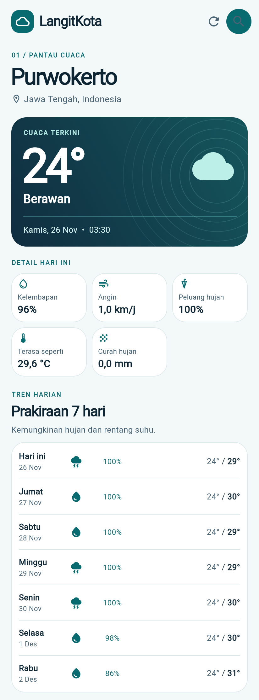
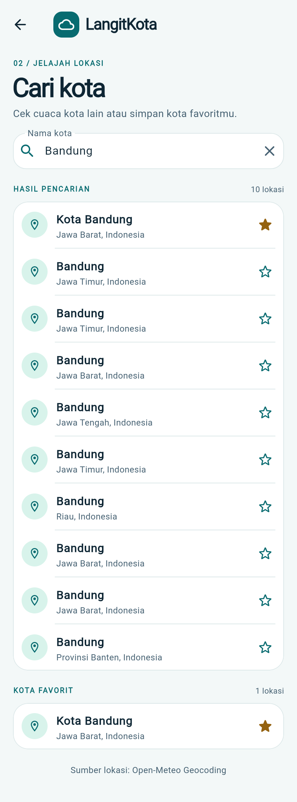

# LangitKota

LangitKota adalah aplikasi Flutter untuk melihat cuaca terkini dan prakiraan tujuh hari dari **Open-Meteo**. Cari kota, pilih hasil yang sesuai, lalu tandai kota yang sering kamu cek. Kota terakhir, favorit, dan delapan kota yang terakhir dibuka disimpan di perangkat.

## Tampilan

| Cuaca / Home | Pencarian / Lokasi |
| :---: | :---: |
|  |  |

[Lihat tata letak layar lebar](docs/screenshots/desktop.png).

## Menjalankan aplikasi

Pasang Flutter SDK, lalu dari folder proyek jalankan:

```sh
flutter pub get
flutter run -d chrome  # Flutter Web
flutter devices
flutter run            # pilih perangkat Android yang terhubung
```

Butuh koneksi internet untuk cuaca dan pencarian; tidak perlu API key. Purwokerto adalah lokasi awal, bukan data cuaca bawaan. Tekan ikon muat ulang atau tarik layar ke bawah untuk mengambil data terbaru.

## Arsitektur MVVM

```text
lib/
├── main.dart              # inisialisasi locale dan penyimpanan
├── app.dart               # MaterialApp + siklus hidup WeatherModel
├── models/               # Place, WeatherReport, CurrentWeather, DailyWeather
├── data/                 # OpenMeteo (HTTP GET), LocalPlaces (penyimpanan)
├── viewmodels/           # WeatherModel dan SearchModel
└── views/                # WeatherScreen, SearchScreen, Theme Material 3
```

**View** menampilkan data dan meneruskan aksi pengguna. **ViewModel** menjalankan pencarian atau pemuatan cuaca, menyimpan status loading/kosong/error, lalu memanggil `notifyListeners()`; `ListenableBuilder` membangun ulang bagian yang mendengarkan. **Model** mendefinisikan data hasil parsing JSON; API dan penyimpanan dipisahkan di `data/`.

Contoh alur: mengetik nama kota → `SearchModel.changeQuery()` menunggu 400 ms → `OpenMeteo.search()` mengirim GET → hasil berubah menjadi daftar `Place` → pengguna memilih kota → `WeatherModel.choose()` meminta cuaca berdasarkan koordinatnya dan menyimpan lokasi terakhir. Nomor urut permintaan mencegah respons lama menimpa hasil terbaru. `StatefulWidget` menangani siklus hidup controller dan state; komponen tampilan menggunakan `StatelessWidget`.

## Implementasi API

| Fitur | Permintaan dan pemetaan |
| --- | --- |
| Pencarian | [Geocoding API](https://open-meteo.com/en/docs/geocoding-api) · `GET /v1/search` dengan `name`, `count=10`, `language=id` |
| Cuaca terkini | [Weather Forecast API](https://open-meteo.com/en/docs) · `GET /v1/forecast` dengan `latitude`, `longitude`, `timezone=auto`, `forecast_days=7`. Bagian `current`: `temperature_2m`, `relative_humidity_2m`, `apparent_temperature`, `precipitation`, `weather_code`, `wind_speed_10m`, `is_day`. |
| Prakiraan | Bagian `daily`: `weather_code`, `temperature_2m_max`, `temperature_2m_min`, `precipitation_probability_max`. Peluang hujan di layar utama memakai maksimum harian pada **tanggal lokal kota**, bukan peluang pada menit ini. Curah hujan terkini adalah jumlah dalam mm dari `current.precipitation`. |

Kode cuaca WMO diterjemahkan menjadi label dan ikon. Field opsional yang hilang ditampilkan sebagai `—`, bukan angka nol. Bila data gagal dimuat, layar menawarkan **Coba lagi**. Saat penyegaran kota yang sama gagal, data terakhir tetap tampil bersama pesan galat. Hanya metadata kota yang disimpan dengan SharedPreferences; tidak ada suhu atau prakiraan dummy di aplikasi.

## Pengujian

```sh
dart format --output=none --set-exit-if-changed lib test
flutter analyze
flutter test
```

Pengujian mencakup parameter GET, parsing field, kondisi kosong dan galat, favorit dan riwayat yang dipulihkan, respons usang, dan interaksi dua layar di viewport ponsel. `MockClient` dipakai hanya di pengujian; aplikasi produksi menghubungi Open-Meteo langsung.

[Catatan dan alur penjelasan kode](docs/penjelasan-kode.md)
